  

  
  
  
  

---

### Sobre mim

- 👋 Tenho <!--AGE-->20<!--/AGE--> anos e programo desde 2022
- 💼 Desenvolvedor full stack na [**SMP Soluções**](https://smpsolucoes.com.br/): sistemas internos, e-commerce e automações
- 🚀 Cuido do produto de ponta a ponta: modelagem do banco, APIs, interfaces e deploy (Vercel, VPS com PM2)
- 🔌 Experiência com integrações: pagamentos (Mercado Pago, Stripe), frete (Frenet), NF-e na SEFAZ, e-mails transacionais (Resend) e armazenamento na AWS
- 🎓 Técnico em Desenvolvimento de Sistemas pela **Etec Philadelpho Gouvêa Netto**
- 🎲 Meu TCC foi o [**EasyD20**](https://github.com/MeChamaDeCarinha/EasyD20-old), um projeto de RPG digital
- 🌱 Estudando Go

### O que eu construo

**🛒 [SMP Shopping](https://www.smpshopping.com.br)** · e-commerce completo, em produção 
Vitrine, carrinho e checkout com Mercado Pago (cartão e Pix), cotação de frete e etiquetas pela Frenet, emissão de NF-e direto na SEFAZ-SP e painel administrativo com sugestões de produto geradas por IA. 
`Next.js` `Prisma` `PostgreSQL` `AWS S3` `Resend`

**📊 Sistema interno de vendas B2B** · CRM e comissionamento 
Plataforma para uma revenda de telecom: importa a carteira de clientes de várias planilhas, acompanha leads, propostas e cada item contratado, e calcula comissões, adiantamentos e estornos dos vendedores. Inclui dashboards em tempo real, portal de acompanhamento para o cliente e modo TV. 
`React` `Express` `Socket.io` `Prisma` `MongoDB`

**🍽️ Cardápio+** · SaaS de cardápio digital 
O restaurante monta o cardápio, compartilha por QR Code e paga uma assinatura por cardápio. Atualmente sendo reescrito de Vite + Express + MongoDB para Next.js + Stripe. 
`Next.js` `Stripe` `Prisma`

**🏢 Base de CNPJs** · ETL + consulta 
Pipeline em Go que baixa os dados abertos da Receita Federal, converte e carrega milhões de empresas no PostgreSQL com `COPY`, e um site para filtrar empresas por CNAE e município. 
`Go` `pgx` `PostgreSQL` `React`

### Stack do dia a dia

  
   
  

| Área | Ferramentas |
| --- | --- |
| **Frontend** | TypeScript, React, Next.js, Vite, Tailwind CSS, shadcn/ui |
| **Backend** | Node.js, Bun, Express, Socket.io, Zod, Go |
| **Dados** | Prisma, PostgreSQL, MongoDB, SQLite |
| **Outros** | Vercel, PM2, AWS S3 |

---

  <i>Obrigado pela visita! 🐍</i>

